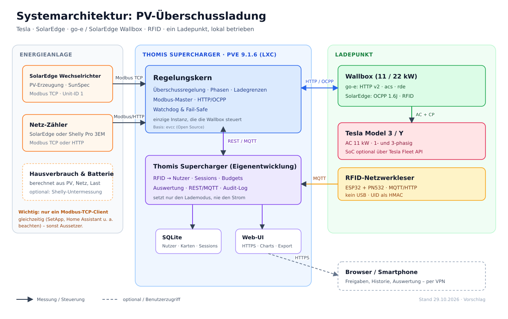
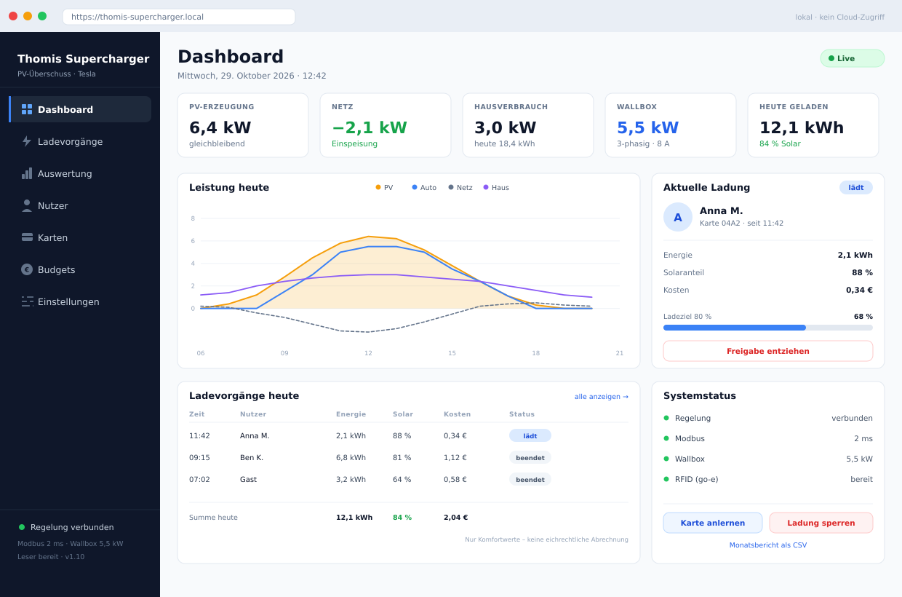
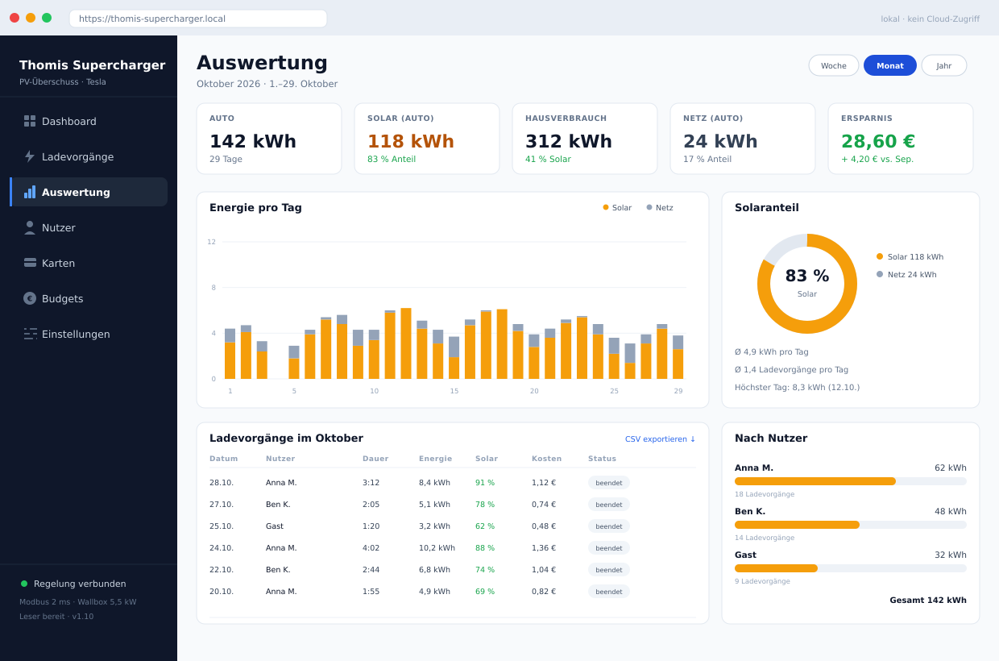
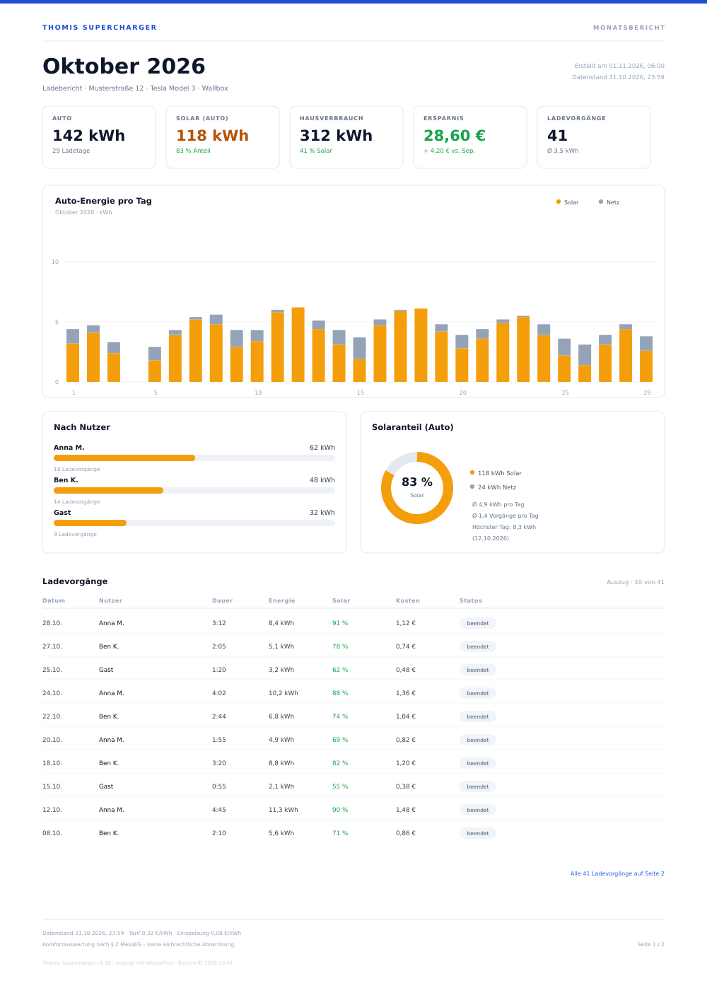

# Thomis Supercharger – Intelligente PV-Überschussladung für Tesla und SolarEdge

**Vorschlag zur Umsetzung** · Version 1.15 · 29.10.2026
Ein Ladepunkt, lokal betrieben, mit RFID-Benutzerverwaltung

> **Zum Namen:** **Thomis Supercharger** ist der Produktname. Der Regelungskern ist **evcc** (Open Source) und bleibt als eigenständige Open-Source-Komponente gekennzeichnet; er wird nicht als Eigenentwicklung ausgegeben.

---

## 1. Kurzfassung

Die Aufgabe besteht aus **zwei getrennten Problemen**, die man auch getrennt lösen sollte:

1. **Leistungsregelung** – wie viel Strom darf das Auto bekommen, damit möglichst wenig Netzbezug entsteht?
2. **Identität und Berechtigung** – wer lädt, wie viel, auf wessen Rechnung?

**Der Regelungskern (evcc) löst Problem 1 sehr gut** (Modbus, Phasenumschaltung, Ladegrenzen, Watchdog, erprobte Treiber). **Problem 2 löst der Regelungskern nur ansatzweise**: Es kennt RFID-Kennungen und ordnet sie Fahrzeugen zu, aber keine Benutzerkonten, Rollen, Kartenverwaltung, Budgets oder Abrechnung.

**Empfehlung:** nicht alles neu bauen, sondern den Open-Source-Regelungskern **evcc** einsetzen und einen schlanken, selbst entwickelten **Thomis Supercharger** daneben stellen, der die Benutzerverwaltung übernimmt. Der Thomis Supercharger steuert die Wallbox **nicht selbst**, sondern schaltet nur den Lademodus in evcc frei oder sperrt ihn. So gibt es genau eine Instanz, die den Ladestrom regelt.

| Baustein | Lösung | Warum |
|---|---|---|
| Netzleistung messen | SolarEdge-Zähler über Modbus TCP | echte Messung statt Schätzung |
| Zusatzmessung (optional) | Shelly Pro 3EM / 1PM | Untermessung, Redundanz, Schalten |
| Hausverbrauch | berechnet aus PV, Netz, Batterie, Wallbox | Anzeige und Auswertung |
| Überschuss regeln | **Regelungskern (evcc)** | erprobt, Phasenwechsel, Modi, Watchdog |
| Wallbox ansteuern | go-e (HTTP v2) **oder** SolarEdge ONE (OCPP) | beide lokal, keine Cloud nötig |
| Controller | **Proxmox LXC** (Debian, systemd) | kein Extra-Gerät, Backup über Proxmox |
| Identität / RFID | **Thomis Supercharger** (Eigenentwicklung) | Konten, Karten, Budgets, Historie |
| Bedienung & Auswertung | Web-Dashboard + Monatsberichte | Live-Überblick, Historie, Kosten pro Nutzer |
| Auto (optional) | Tesla Fleet API | SoC, Ladegrenze – nicht regelungsrelevant |

**Aufwand und Kosten (Rahmen):**

| | Stufe 1: Regelkern | Stufe 2: Thomis Supercharger |
|---|---|---|
| Aufwand | 2–3 Personentage | 4–6 Wochen |
| Hardware | ca. 0–50 € (Proxmox vorhanden; sonst +170 €) | + ca. 40 € RFID-Leser |
| Ergebnis | Überschussladen, 10 RFID-Karten, evcc-Oberfläche | SvelteKit-Dashboard, Auswertung, PDF-Monatsbericht, Benutzerverwaltung, Budgets, Abrechnung (MID) |
| Risiko | niedrig | mittel |

GUI und Auswertung sind fester Bestandteil von Stufe 2: Live-Dashboard, Ladehistorie, Monatsauswertung pro Nutzer sowie ein PDF-Monatsbericht per E-Mail und zum Download.

Stufe 1 setzt ein vorhandenes RFID-Modul an der go-e-Wallbox voraus. Fehlt es, kommen ca. 50 € dafür hinzu – oder man steigt direkt mit dem externen Leser ein.

**Wichtigste Voraussetzung:** Eine Messung der **Netzleistung am Hausanschluss**. Ohne Netz-Zähler ist Überschussladen nur eine Schätzung aus PV-Erzeugung und angenommenem Hausverbrauch – und damit unzuverlässig. Ist am SolarEdge-Wechselrichter ein Zähler (z. B. SE-MTR-3Y) installiert, ist die Messung bereits vorhanden.

> **Begriffsannahme:** Du schreibst „solid edge“ – ich gehe von einem **SolarEdge**-Wechselrichter aus (Solid Edge ist ein CAD-Programm). Mit „Ladestation“ ist wahlweise ein go-e Charger (HOMEfix, PRO oder Gemini flex) oder die SolarEdge ONE EV Charger gemeint. Falls ein anderes Fabrikat gemeint ist, ändert sich nur die Messanbindung; die Architektur bleibt gleich.

---

## 2. Ziele und Anforderungen

### 2.1 Muss-Anforderungen

| ID | Anforderung | Warum |
|---|---|---|
| M1 | Ladestrom stufenlos am PV-Überschuss ausrichten (6–16 A) | max. Eigenverbrauch, min. Netzbezug |
| M2 | Ein- und dreiphasig laden, automatisch umschalten | 1,4 kW Schwelle statt 4,2 kW |
| M3 | Bei Datenverlust oder Störung sicher abschalten | kein unkontrollierter Netzbezug |
| M4 | Laden nur für berechtigte RFID-Karten | Missbrauch verhindern |
| M5 | Jede Ladung einem Benutzer zuordnen | Transparenz, Abrechnung |
| M6 | Betrieb ohne Internet / ohne Cloud | Ausfallsicherheit, Datenschutz |
| M7 | Ladevorgang bei „Auto voll“ oder Abstecken beenden | saubere Sessions |
| M8 | Web-Dashboard mit Live-Leistung und aktuellem Ladevorgang | Überblick im Alltag |
| M9 | Auswertung nach Zeitraum, Nutzer, Solaranteil und Kosten | Transparenz, Optimierung |
| M10 | PDF-Monatsbericht mit Kennzahlen, Diagrammen und allen Sessions, für alle Nutzer | Dokumentation, Transparenz |
| M11 | Wallbox-Zugangskontrolle (`acs`), UID-Meldung (`rde`) und Ladungssperre (`frc`) im UI schaltbar | Sicherheit, Datenschutz |
| M12 | Hausverbrauch anzeigen und nach Tag/Monat auswerten | Verbrauchstransparenz |

### 2.2 Soll-Anforderungen

| ID | Anforderung |
|---|---|
| S1 | Gastkarten mit Zeit- oder Energielimit |
| S2 | Benachrichtigung bei Störung (Telegram, E-Mail, Home Assistant) |
| S3 | Tesla-Ladezustand und Ladegrenze (Komfort, optional) |
| S4 | Ladepläne / Nachtstrom (falls dynamischer Tarif) |

### 2.3 Kann-Anforderungen

| ID | Anforderung |
|---|---|
| K1 | Dynamischer Stromtarif (Börsenpreis) |
| K2 | PV-Prognose und vortägige Planung |
| K3 | §14a-EnWG-Dimmung durch den Netzbetreiber |
| K4 | Abrechnung mit MID-Zähler (Eichrecht) |
| K5 | Mehrere Ladepunkte / Lastmanagement |
| K6 | Shelly als alternativer Netz-Zähler oder Untermesser |

### 2.4 Abgrenzung

Nicht Teil dieses Vorschlags: öffentliches Laden mit OCPP-Roaming, Bezahlterminals, mehrere Standorte, White-Label-Betrieb. Diese Punkte sind architektonisch möglich, würden aber einen anderen Aufwand und andere rechtliche Anforderungen bedeuten.

---

## 3. Ausgangslage und Annahmen

| Komponente | Annahme | Zu prüfen |
|---|---|---|
| Wechselrichter | SolarEdge SE-… (ein- oder dreiphasig), Modbus TCP aktivierbar | genaues Modell, Firmware, SetApp-Zugang |
| Netz-Zähler | SolarEdge SE-MTR-3Y am Einspeisepunkt, alternativ Shelly Pro 3EM | vorhanden? korrekt als Netz-Zähler konfiguriert? |
| Speicher | optional vorhanden | Marke, Steuerbarkeit, SoC-Schnittstelle |
| Wallbox | go-e Charger (HTTP v2) oder SolarEdge ONE EV Charger (OCPP) | Modell, Firmware, RFID-Modul vorhanden? |
| Fahrzeug | Tesla Model 3 / Model Y, 11 kW AC | Ladegrenze, SoC-Abfrage gewünscht? |
| Netzwerk | LAN oder stabiles WLAN am Carport | Kabel bevorzugt |
| Standort | Einfamilienhaus, ein Ladepunkt | Mehrbenutzer? Vermietung? |
| Controller | Proxmox VE **9.1.6**, LXC mit Debian 13, 2 vCPU / 2 GB RAM | Storage, freie Ressourcen, VLAN |
| RFID | Netzwerkleser ESP32 + PN532 | Strom, WLAN/LAN, MQTT |

Die Wallbox wird von einer Elektrofachkraft installiert und beim Netzbetreiber angemeldet. Das ist keine Aufgabe für den Controller, sondern Voraussetzung für den Betrieb.

### 3.1 Warum der Netz-Zähler entscheidend ist

Der Wechselrichter kennt nur die **PV-Erzeugung**. Ob Strom ins Netz fließt oder aus dem Netz bezogen wird, hängt vom gleichzeitigen Hausverbrauch ab. Nur ein Zähler am Hausanschluss (oder ein entsprechend konfigurierter SolarEdge-Zähler) liefert die Größe, die für Überschussladen wirklich zählt:

```
P_Überschuss = −P_Netz − P_Reserve
```

Der Hausverbrauch wird parallel geführt:

```
P_Haus = P_PV + P_Batterie − P_Netz − P_Wallbox
```

Dabei ist `P_Netz` positiv bei Bezug und negativ bei Einspeisung. Ohne diese Messung müsste man den Hausverbrauch raten – das führt zu Netzbezug oder verschenktem PV-Strom.

---

## 4. Architektur



### 4.1 Komponenten und Rollen

Der Controller läuft als LXC-Container auf dem Proxmox-Host. Ein Raspberry Pi ist nur die Alternative, wenn kein Proxmox-Server vorhanden ist.

| Komponente | Rolle | Schnittstelle |
|---|---|---|
| Proxmox LXC | Debian 13, systemd, Caddy, SQLite | Container auf PVE 9.1.6 |
| SolarEdge Wechselrichter | PV-Erzeugung, optional Batterie | Modbus TCP, Unit-ID 1 |
| Netz-Zähler | SolarEdge oder Shelly Pro 3EM | Modbus TCP bzw. HTTP |
| Shelly (optional) | Untermessung, Schalten | HTTP/MQTT |
| **evcc** | einzige Regelungsinstanz: Messen, Regeln, Freigeben, Phasenwechsel | Modbus TCP, HTTP/OCPP zur Wallbox |
| **Thomis Supercharger** | Benutzer, Karten, Sessions, Budgets, UI | REST/MQTT zu evcc, SQLite |
| Wallbox | go-e oder SolarEdge ONE EV Charger | HTTP API v2 bzw. OCPP 1.6J |
| RFID-Erfassung | go-e-Modul, SolarEdge `idTag` oder extern | HTTP/MQTT/OCPP |
| Tesla | Fahrzeug, optional SoC | Tesla Fleet API (Cloud, optional) |

### 4.2 Datenfluss

1. evcc liest alle 1–2 s die Netzleistung am Zähler und die PV-Leistung am Wechselrichter.
2. evcc berechnet den Überschuss und stellt den Ladestrom an der go-e-Wallbox.
3. Der RFID-Leser meldet die Karte an den Thomis Supercharger.
4. Der Thomis Supercharger prüft Berechtigung, Budget und Gültigkeit und schaltet den passenden **Lademodus** in evcc frei (oder sperrt ihn).
5. evcc regelt weiter – der Thomis Supercharger fasst Stromstärke und Phasen **nie** direkt an.
6. Nach dem Abstecken schließt der Thomis Supercharger die Session und ordnet sie dem Benutzer zu.

### 4.3 Vier Architekturprinzipien

1. **Eine Regelungsinstanz.** Nur evcc schreibt auf die Wallbox. Zwei Regler (evcc und ein eigener Dienst) würden sich gegenseitig überschreiben.
2. **Am Netz messen, nicht am Wechselrichter.** Die Netzleistung ist die Wahrheit.
3. **Fail-safe.** Geht die Messung verloren, wird die Ladung beendet – nicht mit dem letzten Wert weiterfahren. evcc erkennt den Fehler; zusätzlich überwacht der Thomis Supercharger die Aktualität der Messwerte und sperrt notfalls.
4. **Identität getrennt von Regelung.** Benutzerverwaltung darf die Regelung nicht blockieren; umgekehrt darf ein Admin-Ausfall nicht zu unkontrolliertem Laden führen.

---

## 5. Schnittstellen im Detail

### 5.1 SolarEdge (Modbus TCP / SunSpec)

SolarEdge-Wechselrichter stellen einen SunSpec-Modbus-Server bereit. evcc liest daraus die PV-Leistung (Modelle 101/103) und – falls vorhanden – den Netz-Zähler (Modell 203).

**Eckdaten:**

| Punkt | Wert |
|---|---|
| Protokoll | Modbus TCP, SunSpec |
| Unit-ID | 1 |
| Port | 502 (bei manchen Setups 1502 – in SetApp prüfen) |
| PV-Register | SunSpec 101/103 (Leistung, Energie, Ströme, Spannungen) |
| Netz-Zähler | SunSpec 203, Subdevice 1 |
| Abtastrate | 1–2 s |

**Wichtige Einschränkung:** Es darf **nur ein Modbus-TCP-Client gleichzeitig** auf den Wechselrichter zugreifen. Läuft bereits Home Assistant, ein SolarEdge-Tool oder eine zweite evcc-Instanz auf Port 502, kommt es zu Aussetzern. Lösung: nur evcc zugreifen lassen und Home Assistant über die evcc-Integration oder MQTT anbinden.

**Einrichtung (grob):**

1. In SetApp „Modbus TCP“ aktivieren, Port notieren.
2. Zähler als Netz-Zähler konfigurieren (Import/Export).
3. Erreichbarkeit prüfen: `nc -zv <WR-IP> 502`.
4. In evcc als `grid` (Zähler) und `pv` (Wechselrichter) eintragen.
5. Mit `evcc meter` die Werte plausibilisieren: Bei Sonne muss `pv` > 0 sein, `grid` bei Einspeisung negativ.

**Wenn kein SolarEdge-Zähler vorhanden ist:** externen Zähler am Hausanschluss nachrüsten (z. B. Eastron SDM630 per Modbus oder Shelly Pro 3EM per HTTP). Für reine Komfortnutzung genügt ein genauer, schnell abtastender Zähler; für Abrechnung ist ein MID-Zähler nötig.

### 5.2 Wallbox: go-e oder SolarEdge

Für den Ladepunkt kann entweder die go-e oder die SolarEdge ONE EV Charger verwendet werden. Pro Ladepunkt ist genau eine Wallbox aktiv; beide gleichzeitig ergeben zwei Ladepunkte.

#### 5.2.1 go-e Charger (HTTP API v2)

Die go-e-Wallbox lässt sich vollständig lokal steuern. Die API v2 muss in der go-e-App aktiviert sein (Firmware aktuell halten). Die go-e-Cloud ist für diesen Betrieb nicht nötig – lokal ist schneller und funktioniert auch ohne Internet.

**Die wichtigsten Aufrufe:**

| Zweck | Aufruf | Anmerkung |
|---|---|---|
| Status lesen | `GET http://<ip>/api/status?filter=car,alw,amp,psm,nrg,wh,eto,trx,cards,acs,rde,lri,lrr,modelStatus` | Werte in einem Rutsch |
| Strom setzen | `GET http://<ip>/api/set?amp=10` | ganzzahlige Ampere, 6–32 |
| Freigabe | `GET http://<ip>/api/set?frc=2` | `2` = laden, `1` = sperren, `0` = neutral |
| Phasenmodus | `GET http://<ip>/api/set?psm=1` bzw. `psm=2` | `1` = einphasig, `2` = dreiphasig |
| Karten | Statusfeld `cards[]`, `trx` | Name der aktiven Karte (Zugangskontrolle) |

**Statusfelder (gekürzt):**

| Feld | Bedeutung |
|---|---|
| `car` | 1 = frei, 2 = lädt, 3 = wartet auf Auto, 4 = fertig |
| `alw` | Laden erlaubt |
| `amp` | aktueller Ladestrom in A |
| `psm` | Phasenmodus |
| `nrg` | Spannungen, Ströme, Leistungen je Phase |
| `wh` | Energie der laufenden Session |
| `eto` | Gesamtenergie |
| `trx` | Index der aktiven RFID-Karte |
| `cards[]` | angelernte Karten (Name, Energie, Kennung) |
| `acs` | Zugangskontrolle: `0` = offen, `1` = Karte nötig, `2` = EVCMS |
| `rde` | RFID-UID an API/MQTT senden |
| `lri` | letzte gelesene UID (bei `rde=true`) |
| `lrr` | Zeitpunkt der letzten Lesung (ms seit Boot) |
| `modelStatus` | `2` = „wartet auf Freigabe“ (Zugangskontrolle) |

**RFID an der Wallbox – zwei Betriebsarten:**

*Zugangskontrolle (`acs=1`):* Die Wallbox lernt bis zu **10 Karten** an, blockiert unbekannte Karten und meldet den Kartennamen über `cards[]`/`trx`. evcc kann den Namen einem Fahrzeug zuordnen. Für Familien ohne eigene Verwaltung eine einfache Lösung.

*Lesebetrieb (`acs=0`, `rde=true`):* Die Wallbox blockiert nicht, sondern meldet die UID der zuletzt gelesenen Karte über `lri` (Zeitpunkt `lrr`). Die Freigabe entscheidet der Thomis Supercharger. Das ist der Modus für Stufe 2 – die Wallbox wird zum reinen Kartenleser.

**Wichtig:** `acs` und `rde` sind getrennte Schalter. Beide lassen sich über die API und die Oberfläche umstellen; `frc=1` sperrt die Ladung sofort. Die 10-Karten-Grenze betrifft nur die interne Zugangskontrolle (`acs=1`). Ob der Lesebetrieb auch **nicht angelernte** Karten als `lri` meldet, muss mit der eingesetzten Firmware getestet werden (T10).

**Sicherheit:** Die lokale API der Wallbox ist **nicht authentifiziert**. Deshalb gehört die Wallbox in ein eigenes Netzsegment (VLAN), das nur der Controller erreichen darf.

**Phasenumschaltung – muss funktionieren:**

Die go-e schaltet intern zwischen einer und drei Phasen. evcc gibt den Modus über `psm` vor (`1` = einphasig, `2` = dreiphasig). Der Ablauf ist bewusst langsam, damit das Auto die Pause toleriert:

| Schritt | Aktion | Warten / Prüfung |
|---|---|---|
| 1 | `frc=1` – Ladung stoppen | bis `car` nicht mehr `2` ist |
| 2 | Pause | 30 s |
| 3 | `psm=1` oder `psm=2` | – |
| 4 | `amp=6` – Mindeststrom | – |
| 5 | `frc=2` – starten | – |
| 6 | `car=2` prüfen | max. 60 s, ein Retry |

**Regeln:**

- `psm` **nie während einer laufenden Ladung** ändern.
- Die go-e nicht zusätzlich auf automatischen Phasenwechsel stellen – evcc gibt den Modus vor, sonst flattern die Phasen.
- Hysterese: 1P→3P oberhalb von 4,3 kW für 5 min; 3P→1P unter 3,9 kW für 10 min.
- Mindestens 10 min zwischen zwei Wechseln, maximal 6 pro Tag.
- Bei fehlgeschlagenem Neustart: einmal wiederholen, sonst in 3P bleiben und Alarm auslösen.
- Die go-e-Parameter `psh`, `spl3`, `mptwt`, `mpwst` nur anfassen, wenn die Wallbox selbst regelt; im evcc-Betrieb bleiben sie auf Standard.

#### 5.2.2 SolarEdge ONE EV Charger (OCPP 1.6J)

Die SolarEdge ONE EV Charger (auch Pro) wird über **OCPP 1.6J** eingebunden. Dabei ist die Wallbox der Client und evcc der Server.

| Punkt | Wert |
|---|---|
| Protokoll | OCPP 1.6J, JSON über WebSocket |
| Port | 8887 (evcc) |
| Richtung | Wallbox → evcc |
| RFID | ja, als `idTag` |
| Dimmen | ja |
| Phasenumschaltung | im evcc-Template nicht ausgewiesen |

**evcc-Konfiguration:**

```yaml
chargers:
  - name: carport
    type: template
    template: ocpp-solaredge
    stationid: "solaredge-1"   # optional
    connector: 1
```

In der Wallbox die Backend-URL `ws://<evcc-host>:8887/` eintragen (ggf. mit Stationskennung). Die Verbindung ist **unverschlüsselt und unauthentifiziert** und gehört deshalb ins lokale Netz bzw. VLAN.

**Grenzen:**

- Die Wallbox muss evcc auf Port 8887 erreichen; im Proxmox-LXC Port freigeben.
- Ein **lokales OCPP-Backend** muss in der Wallbox freigeschaltet sein; das ist modell- und firmwareabhängig. Vor dem Kauf oder Umbau testen.
- **Phasenumschaltung** ist im evcc-Template nicht ausgewiesen. Wenn die Wallbox nicht selbst 1P/3P umschaltet, entfällt der Wechsel; die Mindestleistung liegt dann bei 4,1 kW.
- **RFID** kommt als OCPP-`idTag` an, sofern die Wallbox die Karte an das Backend meldet. Ob sie unbekannte Karten selbst blockiert oder zur Autorisierung an evcc gibt, ist firmwareabhängig – im Test klären (T11).
- Der OCPP-Treiber verlangt ein evcc-Sponsoring-Token.
- OCPP 1.6J ist nicht verschlüsselt; keine Portfreigabe aus dem Internet.

**Wahl der Wallbox:**

| Kriterium | go-e | SolarEdge ONE |
|---|---|---|
| Protokoll | HTTP API v2 | OCPP 1.6J |
| Phasenwechsel | ja (`psm`) | im Template nicht vorgesehen |
| RFID | ja (`acs`/`rde`) | ja (`idTag`) |
| Dimmen | ja | ja |
| Betrieb | lokal, ohne Cloud | lokal, OCPP-Server nötig |

**Wichtig:** Nur eine Wallbox pro Ladepunkt. Zwei Wallboxen bedeuten zwei Ladepunkte und ein gemeinsames Lastmanagement.

### 5.3 Tesla (optional)

Für die reine Überschussladung braucht es keine Fahrzeug-API: Die Wallbox regelt den Strom, das Auto lädt einfach. Die Tesla-API ist nur für Komfort und Genauigkeit sinnvoll:

- aktueller Ladezustand (SoC) für „Laden bis 80 %“
- Ladegrenze setzen
- Erkennen, wann das Auto fertig ist

**Realität 2026:** Tesla bietet eine offizielle, aber kostenpflichtige Fleet API. Ein Developer-Account erhält ein monatliches Guthaben (laut evcc-Doku ca. 10 €), das für die üblichen Abfragen meist reicht. Die Einrichtung ist aufwendig (App-Registrierung, OAuth, Tokens); evcc unterstützt sie direkt.

**Wichtig:** Die Tesla-API ist eine **Cloud-Schnittstelle**. Sie darf niemals Voraussetzung für das Laden sein. Fällt das Internet aus, muss die Überschussladung weiter funktionieren – nur der SoC ist dann eben veraltet.

### 5.4 RFID-Erfassung

**Gewählt: Netzwerkleser (ESP32 + PN532).** Der Leser sitzt am Carport und sendet die UID per MQTT oder HTTP an den Thomis Supercharger. Im LXC ist **kein USB-Passthrough** nötig.

| Punkt | Wert |
|---|---|
| Hardware | ESP32 + PN532 (13,56 MHz) |
| Anbindung | WLAN oder LAN/PoE, MQTT/HTTP |
| Stromversorgung | 5 V am Carport |
| Sicherheit | eigenes VLAN, MQTT mit Benutzer/Passwort oder TLS, UID nur als HMAC |
| Reichweite | 3–5 cm |

**Alternative: go-e-Modul.** Wenn die Wallbox ein RFID-Modul hat, kann sie die Karte lesen:

| Schalter | API | Wirkung |
|---|---|---|
| Zugangskontrolle aus | `acs=0` | Wallbox blockiert nicht, liefert die UID |
| UID-Meldung an | `rde=true` | `lri`/`lrr` werden gefüllt |
| Zugangskontrolle an | `acs=1` | nur angelernte Karten, max. 10 |
| Ladung sperren | `frc=1` | sofort aus |

Im Lesebetrieb (`acs=0`, `rde=true`) entscheidet der Thomis Supercharger. Die 10-Karten-Grenze gilt nur für `acs=1`; ob `lri` auch nicht angelernte Karten meldet, muss getestet werden (T10).

**Alternative: SolarEdge-Wallbox.** Dort kommt die Kennung als OCPP-`idTag`; ein separater Leser ist nicht nötig (T11).

**Alternative: USB-Leser.** ACR122U am Proxmox-Host, nur wenn kein Netzwerkleser möglich ist. Dann ist USB-Passthrough in den LXC nötig.

**Sicherheitshinweis:** Reine UID-basierte Systeme (Mifare Classic) sind **klonbar**. Für Komfort und Familie ist das akzeptabel; für Abrechnung mit Fremden nicht. Wer wirklich sicher sein will, nimmt DESFire-Karten mit gegenseitiger Authentifizierung oder zusätzlich einen PIN. In der Datenbank werden UIDs nie im Klartext gespeichert, sondern als HMAC mit geheimem Schlüssel.

### 5.5 Shelly (optional)

Shelly-Geräte lassen sich lokal und ohne Cloud einbinden. Sinnvoll sind drei Rollen:

| Rolle | Gerät | Nutzen |
|---|---|---|
| Netz-Zähler | Shelly Pro 3EM (LAN) oder 3EM Gen1 (WLAN) | Überschuss messen, wenn kein SolarEdge-Zähler vorhanden ist |
| Untermessung | Shelly Pro 3EM, EM, 1PM, Plug S | Haus, Wärmepumpe, Wallbox-Kreis getrennt auswerten |
| Schalten | Shelly 1PM, Pro 1PM, Plug S | Lasten ein-/ausschalten; **nicht** die 11-kW-Wallbox direkt |

**evcc-Unterstützung:** Die Templates `shelly-pro-3em`, `shelly-3em` und `shelly-1pm` sind vorhanden (1PM auch für Plug S, EM, Pro 4PM). Gelesen wird über die lokale HTTP-API; der Pro 3EM hängt bevorzugt per LAN im Netz.

**Wichtig:** Shelly ist **kein MID-Zähler**. Für Steuerung, Untermessung und Auswertung geeignet, für Abrechnung nicht. Beim 3EM/Pro 3EM saldiert der integrierte Energiezähler die Phasen nicht; evcc integriert stattdessen die Leistung. Für die Regelung ist die Leistungsmessung entscheidend, nicht der Energiezähler.

**Einbindung:**

- **Als Netz-Zähler:** `usage: grid`, Host eintragen. Ersetzt den SolarEdge-Zähler, wenn dieser fehlt.
- **Als Untermesser:** Der Thomis Supercharger liest die Shelly direkt (HTTP/MQTT) und zeigt Haus, Wärme und Wallbox getrennt in GUI und PDF.
- **Als Schalter:** Nur für kleinere Lasten oder als Signal für ein Schütz; die Wallbox wird weiterhin über evcc/go-e geregelt.

**Montage:** Die CT-Klemmen gehören an die Zuleitung und werden von einer Elektrofachkraft gesetzt; Richtung (Pfeil zum Verbraucher) beachten, sonst sind die Vorzeichen falsch. LAN ist stabiler als WLAN.

**Grenzen:** WLAN-Latenz und fehlende Eichrechtstauglichkeit. Wenn der SolarEdge-Zähler vorhanden ist, ist Shelly eine Ergänzung, kein Ersatz.

### 5.6 Hausverbrauch

Der Hausverbrauch wird aus der Energiebilanz berechnet – er wird nicht direkt gemessen:

```
P_Haus = P_PV + P_Batterie − P_Netz − P_Wallbox
```

Dabei ist `P_Netz` positiv bei Bezug, `P_Batterie` positiv beim Entladen und `P_Wallbox` die Ladeleistung des Autos. Ohne Batterie vereinfacht sich das zu:

```
P_Haus = P_PV − P_Netz − P_Wallbox
```

**Quellen:**

- **evcc** liefert PV-, Netz-, Batterie- und Ladeleistung; der Thomis Supercharger berechnet daraus den Hausverbrauch und speichert ihn mit den übrigen Messwerten.
- **Shelly** kann den Hausverbrauch zusätzlich direkt messen (z. B. Pro 3EM am Hauskreis oder 1PM an der Wärmepumpe). Das ist genauer für die Aufteilung, aber ein zusätzliches Gerät.

**Anzeige:**

- Dashboard-KPI „Hausverbrauch“ (aktuell in kW, heute in kWh)
- Linie im Tagesverlauf neben PV, Auto und Netz
- Monatsauswertung inkl. Grundlast und Solaranteil
- Block „Hausverbrauch“ im PDF-Monatsbericht

**Grenzen:** Der berechnete Wert enthält Mess- und Wandlungsverluste und ist kein MID-Wert. Für die Aufteilung nach Verbrauchern (Haus, Wärme, Auto) ist eine Shelly-Untermessung sinnvoll.

---

## 6. Regelalgorithmus

### 6.1 Grundgleichung

```
P_Überschuss = −P_Netz − P_Reserve
```

Der Hausverbrauch wird parallel geführt:

```
P_Haus = P_PV + P_Batterie − P_Netz − P_Wallbox
```

- `P_Netz` positiv = Bezug, negativ = Einspeisung
- `P_Reserve` = kleiner Puffer (z. B. 50 W), damit nicht dauernd zwischen Bezug und Einspeisung gewechselt wird

**Strom pro Phase:**

```
1-phasig:  I = P / 230 V
3-phasig:  I = P / (√3 · 400 V) ≈ P / 693
```

**Mindestleistungen:**

| Phasen | 6 A | 16 A |
|---|---|---|
| 1 | 1,38 kW | 3,68 kW |
| 3 | 4,14 kW | 11,0 kW |

Das Tesla Model 3/Y lädt dreiphasig mit maximal 11 kW (16 A). Einphasig sind bis zu 7,4 kW möglich, begrenzt durch das Fahrzeug.

### 6.2 Zustandsautomat

| Zustand | Bedeutung | Übergang |
|---|---|---|
| `AUS` | kein Auto / keine Freigabe | Auto steckt + Karte gültig → `BEREIT` |
| `BEREIT` | Auto steckt, Laden gesperrt | Überschuss ≥ Startschwelle → `LADEN_1P` |
| `LADEN_1P` | einphasig | Überschuss ≥ 3P-Schwelle für 5 min → `PAUSE` |
| `LADEN_3P` | dreiphasig | Überschuss < 3P-Schwelle für 10 min → `PAUSE` |
| `PAUSE` | Ladung kurz gestoppt, Phasenwechsel | nach 30 s → `LADEN_1P` oder `LADEN_3P` |
| `FEHLER` | Messung/Wallbox gestört | nach Wiederkehr + 60 s → `AUS` |

### 6.3 Ablauf (Pseudocode)

```python
RESERVE_W        = 50
MIN_A            = 6
MAX_A            = 16
START_DELAY_S    = 60
STOP_DELAY_S     = 120
RAMP_A_PER_TICK  = 1

while True:
    grid, pv, bat, car = read_modbus_and_charger()

    # 1. Sicherheit
    if not grid.ok or not charger.ok:
        if outage_seconds() > 30:
            charger.stop()           # frc=1
        sleep(2)
        continue

    # 2. Berechtigung
    if not admin.is_authorized(car.rfid, car.plugged):
        charger.stop()
        sleep(2)
        continue

    # 3. Überschuss
    surplus = -grid.power - RESERVE_W
    if bat.discharging and bat.soc < 25:
        surplus -= bat.discharge_power   # Hausakku nicht leerladen

    # 4. Start / Stopp mit Hysterese – immer einphasig starten
    if not charger.charging:
        if surplus > start_threshold(1) and surplus_since() > START_DELAY_S:
            charger.set_phases(1)
            charger.start()
        sleep(2)
        continue

    if surplus < stop_threshold(charger.phases) and deficit_since() > STOP_DELAY_S:
        charger.stop()
        sleep(2)
        continue

    # 5. Phasenwechsel nur mit Pause, Hysterese und Mindestabstand
    if should_switch_phases(surplus, charger.phases):
        charger.stop()
        sleep(30)
        charger.set_phases(3 if charger.phases == 1 else 1)
        charger.set_amp(MIN_A)
        charger.start()

    # 6. Strom nachführen (gedämpft, begrenzt)
    p_per_amp = 230 if charger.phases == 1 else 693
    target = charger.amp + surplus / p_per_amp
    target = clamp(target, MIN_A, MAX_A)
    target = min(target, charger.amp + RAMP_A_PER_TICK)
    target = max(target, charger.amp - RAMP_A_PER_TICK)
    charger.set_amp(round(target))

    sleep(2)
```

### 6.4 Parameter (Startwerte)

| Parameter | Wert | Erklärung |
|---|---|---|
| Abtastrate | 2 s | Modbus + HTTP |
| Glättung | EMA, τ = 10 s | dämpft Wolken und Messrauschen |
| Reserve | 50 W | Ziel: leichte Einspeisung |
| Totband | ±80 W | keine Nachregelung bei kleinen Schwankungen |
| Startschwelle | Mindestleistung + 200 W | 1,58 kW (1P) / 4,34 kW (3P) |
| Startverzögerung | 60 s | keine Fehlstarts bei Wolken |
| Stoppschwelle | Mindestleistung − 300 W | Hysterese |
| Stoppverzögerung | 120 s | kein Flattern |
| Stromschritt | 1 A pro 2 s | go-e kann nur ganze Ampere |
| Phasenwechsel | ≥ 10 min Abstand, 30 s Pause | Kontaktoren schonen |
| Max. Schaltungen/Tag | 6 | Verschleiß begrenzen |
| Watchdog | 30 s ohne Messwerte → Stopp (Thomis Supercharger) | Fail-safe |

### 6.5 Beispieltag

| Zeit | PV | Haus | Überschuss | Aktion |
|---|---|---|---|---|
| 08:00 | 1,2 kW | 0,6 kW | 0,6 kW | aus (unter 1,4 kW) |
| 10:00 | 3,0 kW | 0,7 kW | 2,3 kW | 1P, 10 A |
| 12:00 | 6,5 kW | 0,9 kW | 5,6 kW | 3P, 8 A |
| 14:00 | 3,2 kW | 1,0 kW | 2,2 kW | Wechsel auf 1P, 9 A |
| 16:00 | 0,9 kW | 1,1 kW | −0,2 kW | Stopp nach 2 min |

Der Wechsel bei 14:00 von 3P auf 1P ist der wichtigste Effekt: Mit drei Phasen würde die Ladung bei 2,2 kW Überschuss abbrechen, einphasig läuft sie mit 9 A weiter.

### 6.6 Sonderfälle

**Hausbatterie:** Wenn ein Speicher vorhanden ist, soll das Auto nicht den Speicher leerladen. Regel: Unterschreitet der Speicher 25 % SoC oder entlädt er gerade, wird die Entladeleistung vom Überschuss abgezogen. Ist der Speicher voll, geht der gesamte PV-Überschuss ins Auto.

**Wolken:** Kurze Einbrüche werden durch Glättung und Stoppverzögerung überbrückt, nicht sofort abgeschaltet.

**Phasenwechsel:** Immer mit Ladepause: `frc=1`, 30 s warten, `psm` setzen, `frc=2`, Strom auf Minimum. Das Fahrzeug muss die Pause tolerieren – Tesla tut das. Bei der SolarEdge-Wallbox ist die Phasenumschaltung im evcc-Template nicht vorgesehen; dann entfällt der Wechsel und es wird dreiphasig ab 4,1 kW geladen. Der genaue go-e-Ablauf steht in Abschnitt 5.2.1.

**Ladeende:** Meldet das Auto „voll“ oder sinkt der Strom unter 6 A, wird die Session beendet und die Freigabe entzogen.

**Nachtstrom / dynamischer Tarif:** Optional kann der Thomis Supercharger zusätzlich das Sofortladen (`now`) freischalten, etwa in günstigen Stunden. Dieser Modus sollte immer ein Zeit- oder Energielimit haben, damit ein Ausfall des Thomis Superchargers nicht zu endlosem Netzbezug führt. Sauberer ist es, die Tariflogik in evcc zu lassen (`smart` mit Tarif) und den Thomis Supercharger nur die Berechtigung beisteuern zu lassen.

---

## 7. Benutzerverwaltung

### 7.1 Was evcc bietet – und was nicht

| Funktion | Regelungskern (evcc) | Thomis Supercharger |
|---|---|---|
| RFID-Kennung lesen | ja (go-e `rde` oder SolarEdge `idTag`) | ja (go-e, SolarEdge oder extern) |
| Kennung einem Fahrzeug zuordnen | ja | ja |
| Ladevorgänge aufzeichnen | ja (pro Fahrzeug) | ja (pro Benutzer) |
| Auswertung pro Nutzer | nein | ja |
| Live-Dashboard | ja (evcc-UI) | ja (eigene UI) |
| Benutzerkonten / Rollen | nein | ja |
| Karten sperren / befristen | nein | ja |
| Monatsbudget / Energielimit | nein | ja |
| Abrechnung (MID) | nein | ja |
| Export | Sessions/CSV in evcc | CSV + API |
| Mehr als 10 Karten | im Lesebetrieb (Test) | ja |

### 7.2 Rollen

| Rolle | Rechte |
|---|---|
| Admin | alles: Nutzer, Karten, Budgets, Einstellungen, Audit-Log |
| Benutzer | eigene Sessions und Budgets sehen, Karte nutzen |
| Gast | einmalige Freigabe mit Limit, kein Konto |

### 7.3 Datenmodell (SQLite)

| Tabelle | Felder (Auszug) |
|---|---|
| `users` | `id`, `name`, `email`, `role`, `active`, `created_at` |
| `rfid_cards` | `id`, `user_id`, `uid_hmac`, `label`, `valid_from`, `valid_to`, `active` |
| `sessions` | `id`, `user_id`, `card_id`, `evcc_session_id`, `started_at`, `ended_at`, `energy_kwh`, `solar_kwh`, `cost_eur`, `status` |
| `measurements` | `ts`, `pv_w`, `grid_w`, `battery_w`, `charger_w`, `house_w` |
| `daily_stats` | `date`, `user_id`, `car_kwh`, `house_kwh`, `solar_kwh`, `grid_kwh`, `cost_eur` |
| `reports` | `id`, `period`, `generated_at`, `file_path`, `sha256`, `snapshot_json` |
| `budgets` | `id`, `user_id`, `period`, `kwh_limit`, `eur_limit` |
| `audit` | `id`, `ts`, `actor`, `action`, `details` |

`uid_hmac` ist ein HMAC-SHA256 über die Karten-UID mit einem geheim gehaltenen Schlüssel. Die Roh-UID wird nirgends gespeichert.

### 7.4 Ablauf einer Ladung

1. Auto wird angesteckt; go-e meldet `car=3` (wartet) oder `car=2`.
2. Die Wallbox liest die Karte: bei go-e über `lri`/`lrr` (`rde=true`), bei SolarEdge als OCPP-`idTag`. Der Thomis Supercharger holt die Kennung per HTTP/MQTT bzw. aus der OCPP-Transaktion.
3. Der Thomis Supercharger prüft: Karte aktiv? gültig? Benutzer aktiv? Budget frei?
4. Bei Erfolg: Thomis Supercharger setzt den evcc-Lademodus auf `smart` und merkt sich die Freigabe. Die Session startet, sobald evcc „lädt“ meldet.
5. Bei Ablehnung: Modus bleibt `off`; die Wallbox bleibt gesperrt; optional LED/Telegram-Hinweis.
6. evcc regelt die Ladung; der Thomis Supercharger liest zyklisch den Session-Fortschritt (MQTT/REST, REST mit evcc-API-Key).
7. Beim Abstecken oder nach 10 min ohne Ladung: Session beenden, Energie und Solaranteil speichern, Modus auf `off`.

**Wichtig:** Der Thomis Supercharger ändert **nur den Modus** (`off`, `smart`, `now`; die alten Werte `pv`/`minpv` werden von evcc noch akzeptiert), nie `amp` oder `psm`. Damit bleibt evcc die einzige Regelungsinstanz.

**Voraussetzung für Stufe 2:** `acs=0` (Wallbox blockiert nicht) und `rde=true` (UID wird gemeldet). Dann entscheidet der Thomis Supercharger. In Stufe 1 (nur evcc) kann `acs=1` bleiben, dann gelten die 10 angelernten Karten. Bei SolarEdge muss die Wallbox die Karte als `idTag` an evcc melden; die go-e-Schalter entfallen dort.

**Freigabe gilt pro Steckverbindung:** Nach dem Abstecken wird die Freigabe entzogen. Steckt jemand anderes an, muss erneut eine Karte vorgehalten werden. Im Stufe-2-Betrieb sollte die evcc-Oberfläche und der evcc-API-Key nur für Admins erreichbar sein – sonst lässt sich die Freigabe über die evcc-UI umgehen.

### 7.5 Limits und Budgets

- **Monatslimit** pro Benutzer (kWh oder €). Ist es erreicht, wird die Freigabe verweigert.
- **Gastkarte** mit einmaligem Limit (z. B. 20 kWh) und automatischer Sperrung danach.
- **Zeitfenster** (z. B. nur 18–8 Uhr) für bestimmte Nutzer.
- **Warnung** bei 80 % des Budgets per E-Mail/Telegram.

### 7.6 GUI

Die Oberfläche ist kein Anhängsel, sondern der Ort, an dem die Anlage bedienbar wird. Sie muss im Alltag drei Fragen in wenigen Sekunden beantworten: **Lädt es? Mit welchem Strom? Wer lädt?** Und sie muss die Verwaltung in wenigen Klicks erledigen.

Die beiden Entwürfe zeigen den geplanten Aufbau (Mockup, keine fertige Implementierung):



*Dashboard: Live-Leistung, aktuelle Ladung, Tageshistorie und Systemstatus.*



*Auswertung: Kennzahlen, Tagesbalken, Solaranteil und Vergleich nach Nutzer.*

#### 7.6.1 Bereiche

| Bereich | Inhalt | Zielgruppe |
|---|---|---|
| Dashboard | Live-Kennzahlen inkl. Hausverbrauch, aktuelle Session, Tagesverlauf, Systemstatus | alle |
| Ladevorgänge | Liste, Filter, Detailansicht, CSV-Export | Benutzer (eigene), Admin (alle) |
| Auswertung | Kennzahlen, Tagesbalken, Solaranteil, Nutzervergleich | Admin, Benutzer (eigene) |
| Nutzer | anlegen, bearbeiten, Rollen, deaktivieren | Admin |
| Karten | anlernen, zuordnen, sperren, befristen | Admin |
| Budgets | Monatslimits, Verbrauch, Warnungen | Admin |
| Einstellungen | Preise, Tarife, Schwellen, Shelly-Geräte, Benachrichtigungen | Admin |
| Audit | wer hat wann freigegeben oder geändert | Admin |

#### 7.6.2 Bedienprinzipien

- **Status auf einen Blick:** Die wichtigsten Werte stehen oben, farbcodiert (Einspeisung grün, Bezug neutral, Fehler rot).
- **Drei Klicks:** Karte anlernen, Freigabe entziehen, Monatsbericht exportieren.
- **Mobil:** Die Oberfläche ist responsiv; Karten lassen sich auch am Handy anlernen.
- **Klar:** deutsche Beschriftung, kWh und €, verständliche Fehlermeldungen statt technischer Codes.
- **Lokal:** kein Cloud-Konto, TLS im LAN, Zugriff von außen nur über VPN.

#### 7.6.3 Technik

| Schicht | Vorschlag | Warum |
|---|---|---|
| Frontend | SvelteKit (Svelte 5, TypeScript, Tailwind) | schlank, SSR, Form Actions, gute Developer Experience |
| Charts | ECharts | Zeitreihen, Zoom, deutsche Formatierung |
| PDF | WeasyPrint + Jinja2 | HTML/CSS nach A4, ohne Headless-Browser |
| Backend | FastAPI (Python 3.12) | REST + SSE, passt zu evcc und MQTT |
| Datenbank | SQLite (WAL) | ein Haushalt, kein DB-Server; Postgres bei Wachstum |
| Live-Daten | SSE mit 2 s, Fallback Polling | einfach, firewallfreundlich |
| Anmeldung | Argon2id, Session-Cookie, TOTP optional | lokal, ohne Cloud |
| Deployment | Caddy im LXC (native systemd) oder Docker Compose | TLS im LAN, reproduzierbar |
| Hintergrundjobs | APScheduler oder cron | Aggregation, Berichte, Budget-Warnungen |

#### 7.6.4 API-Skizze

| Methode und Pfad | Zweck |
|---|---|
| `GET /api/live` (SSE) | Live-Werte inkl. Hausverbrauch |
| `GET /api/sessions?from=&to=&user=` | Ladevorgänge filtern |
| `GET /api/stats?period=month&user=` | Kennzahlen und Aggregate |
| `GET /api/meters` | Messwerte inkl. Shelly-Untermessung |
| `POST /api/cards` | Karte anlernen und zuordnen |
| `POST /api/authorize` | Freigabe für eine Session |
| `POST /api/sessions/{id}/close` | Session manuell beenden |
| `GET /api/export/sessions.csv` | Export für Excel |
| `POST /api/charger/access` | Zugangskontrolle `acs` auf Open/Wait stellen |
| `POST /api/charger/rfid` | UID-Meldung `rde` ein-/ausschalten |
| `POST /api/charger/stop` | Ladung sofort sperren (`frc=1`) |
| `GET /api/reports?year=2026` | erzeugte Berichte auflisten |
| `POST /api/reports/2026-10/generate` | Monatsbericht neu erzeugen |
| `GET /api/reports/2026-10.pdf` | PDF herunterladen |

#### 7.6.5 Wallbox-Schalter

Die sicherheitsrelevanten Schalter liegen sichtbar in den Einstellungen – nicht versteckt in der go-e-App:

| Schalter | API | Wirkung |
|---|---|---|
| Zugangskontrolle | `acs=0` / `acs=1` | offen für den Thomis Supercharger / nur angelernte Karten |
| RFID-UID melden | `rde=true` / `rde=false` | Karten werden gelesen / nicht mehr gemeldet |
| Ladung sperren | `frc=1` | sofort aus, unabhängig von Karte und Modus |
| Freigabe | `frc=2` | nur nach Autorisierung durch den Thomis Supercharger |

Nur Admins dürfen diese Schalter bedienen; jede Änderung landet im Audit-Log.

### 7.7 Auswertung

Auswertung ist mehr als ein Diagramm. Sie muss Sessions, Nutzer und Energie sauber zusammenbringen – und ehrlich sagen, was Komfortwert und was abrechenbar ist.

#### 7.7.1 Kennzahlen

| Kennzahl | Berechnung | Aussage |
|---|---|---|
| Gesamtenergie | Summe Session-Energie | Verbrauch im Zeitraum |
| Hausverbrauch | Summe `house_power` | Verbrauch ohne Auto |
| Haus-Solaranteil | Solar-kWh Haus / Haus-kWh | Qualität der Deckung |
| Solaranteil | Solar-kWh / Gesamt-kWh | Qualität des Überschussladens |
| Netzbezug | Gesamt − Solar | teurer Anteil |
| Kosten | Netz-kWh × Arbeitspreis | Belastung |
| Ersparnis | Solar-kWh × (Netzpreis − Einspeisevergütung) | Nutzen gegenüber Einspeisung |
| CO₂ | Netz-kWh × 0,38 kg/kWh | grobe Kennzahl, konfigurierbar |
| Ø Session | Gesamt-kWh / Anzahl Sessions | Ladeverhalten |
| Budget | Monats-kWh / Limit | Auslastung |
| Ladedauer | Summe (Ende − Start) | Belegung des Ladepunkts |

#### 7.7.2 Diagramme

| Diagramm | Auflösung | Zweck |
|---|---|---|
| Leistungsverlauf | 15 s / 1 min, Tag | Regelgüte, Wolken, Spitzen |
| Verbrauchsaufteilung | Tag / Monat | Haus, Wärme, Wallbox (Shelly) |
| Hausverbrauch | Tag / Monat | Grundlast, Muster, Solaranteil |
| Energie pro Tag | Tag, Monat | Muster erkennen |
| Solar vs. Netz | Monat / Jahr | Autarkie und Kosten |
| Nutzervergleich | Monat | Fairness, Budget |
| Kostenverlauf | Monat / Jahr | Entwicklung |
| Ladezeiten | Stunde, Monat | Tarif und Gewohnheiten |

#### 7.7.3 Datenhaltung

| Auflösung | Zweck | Aufbewahrung | Datenmenge (1 Ladepunkt) |
|---|---|---|---|
| 15 s | Live, Debugging | 30 Tage | ca. 170.000 Zeilen |
| 1 min | Tagesprofil | 2 Jahre | ca. 1,0 Mio. Zeilen |
| 1 h | Langzeitvergleich | 5 Jahre | ca. 44.000 Zeilen |
| Tag / Monat | Auswertung | dauerhaft | wenige Tausend Zeilen |

SQLite trägt das für einen Ladepunkt problemlos. Bei mehreren Ladepunkten oder mehreren Jahren lohnt sich Postgres/TimescaleDB.

#### 7.7.4 Export und Berichte

- **CSV** für Sessions und Monatsauswertung pro Nutzer (Excel-freundlich).
- **PDF-Monatsbericht** mit Kennzahlen, Diagrammen und Ladevorgängen (siehe 7.7.5).
- **E-Mail-Versand** am Monatsanfang an **alle aktiven Nutzer und den Admin**.
- **JSON-API** für Home Assistant oder Grafana.
- Berichte sind reproduzierbar: Zeitraum, Tarif und Datenstand werden mitgespeichert.

#### 7.7.5 Monatsbericht (PDF)

Der Bericht wird am 1. des Folgemonats automatisch erzeugt und kann im UI jederzeit neu generiert werden. **Alle aktiven Nutzer und der Admin erhalten denselben vollständigen Bericht** – inklusive aller Sessions und des Gast-Anteils. Ein Logo gibt es nicht; die Kopfzeile bleibt neutral.



*Aufbau des PDF-Berichts (Mockup): Kennzahlen, Tagesverlauf, Nutzervergleich, Solaranteil und Ladevorgänge.*

Ein fertiges Layout-Muster mit beiden Seiten liegt als [Monatsbericht_2026-10.pdf](Monatsbericht_2026-10.pdf) bei. Ist eine Shelly-Untermessung konfiguriert, kommt auf Seite 1 ein Block „Verbrauchsaufteilung“ (Haus, Wärme, Wallbox) hinzu.

| Seite | Inhalt |
|---|---|
| 1 | Kopf mit Anlage und Zeitraum, KPIs inkl. Hausverbrauch, Energie pro Tag, Nutzervergleich, Solaranteil, Auszug der Ladevorgänge |
| 2 | **alle** Ladevorgänge, Datenqualität, Tarifdetails und Hinweise |

**Berichtseinstellungen:**

| Einstellung | Wert |
|---|---|
| Empfänger | alle aktiven Nutzer + Admin |
| Inhalt | alle Sessions, inklusive Gast |
| Logo | keins, neutrale Kopfzeile |
| Format | A4, 2 Seiten (bei vielen Sessions mehrseitig) |
| Versand | 1. des Monats, 06:00 |
| Download | im UI für alle berechtigten Nutzer |

Die Verteilung ist über `report.audience` konfigurierbar: `all` (gesetzt) oder `own` (jeder nur eigene Sessions). Im UI bleibt die Sicht rollenbasiert; der Bericht ist die gemeinsame Transparenzversion. Bei mehr als ca. 45 Sessions wird Seite 2 automatisch umbrochen.

**Erzeugung:**

- Jinja2-HTML-Template mit CSS `@page A4`, Rendering über **WeasyPrint**.
- Diagramme serverseitig als SVG (matplotlib), kein Headless-Browser nötig.
- Datei und Metadaten (Zeitraum, Tarif-Version, Datenstand, SHA-256) werden in der Tabelle `reports` gespeichert.
- Versand per SMTP; Download bleibt immer möglich, auch wenn die Mail nicht ankommt.
- Reproduzierbar: Der Daten-Snapshot wird als JSON mitgespeichert.

#### 7.7.6 Genauigkeit und Abgrenzung

Die Session-Energie kommt aus der go-e (`wh`). Der Solaranteil wird aus den evcc-Leistungswerten integriert (Abtastung 2 s, Trapezregel). Das ist für die Auswertung genau genug (ca. ±3–5 %), aber **kein Eichrecht**. Für Abrechnung gegenüber Dritten braucht es einen MID-Zähler und gespeicherte Rohwerte.

### 7.8 Datenschutz und Recht

- RFID-UIDs sind personenbezogene Daten, sobald sie einem Namen zugeordnet sind. Es braucht ein Verzeichnis der Verarbeitungstätigkeiten, eine Löschfrist und eine Zugriffsbeschränkung.
- Für **Abrechnung gegenüber Dritten** (Mitarbeiter, Mieter, Kunden) gilt zusätzlich das Eichrecht: Es braucht einen MID-konformen Zähler und ein manipulationsgeschütztes Abrechnungsverfahren. Die go-e-Session-Energie aus evcc ist dafür **nicht** ausreichend.
- Für die Familie ohne Abrechnung reicht die Komfortauswertung.
- Der vollständige Monatsbericht zeigt **allen Nutzern auch die Verbräuche der anderen**. In einer Familie ist das meist gewollt; bei Mietern oder Mitarbeitern braucht es dafür eine Einwilligung bzw. Rechtsgrundlage. Deshalb ist `report.audience` umschaltbar (`all`/`own`).

---

## 8. Variantenvergleich

| Kriterium | A: nur evcc | B: evcc + Thomis Supercharger | C: komplett eigen |
|---|---|---|---|
| Regelung | evcc | evcc | eigener Regler |
| RFID | go-e, max. 10 Karten (acs=1) | go-e-Leser (acs=0) oder extern | eigener Leser |
| Benutzerkonten | nein | ja | ja |
| Budgets / Abrechnung | nein | ja | ja |
| GUI / Auswertung pro Nutzer | evcc-UI (pro Fahrzeug) | eigene GUI | eigene GUI |
| Aufwand | 2–3 Tage | 4–6 Wochen | 3–4 Monate |
| Laufender Aufwand | gering | mittel | hoch |
| Risiko | niedrig | mittel | hoch |
| Passt, wenn | Familie, 1–3 Autos | Familie + Gäste + Transparenz | White-Label / besondere Anforderungen |

**Empfehlung: B, in zwei Stufen.**

- **Stufe 1 (sofort):** evcc + go-e-RFID. Damit ist die Technik validiert, und du siehst nach wenigen Tagen, ob die Regelung sauber läuft.
- **Stufe 2 (Ausbau):** Thomis Supercharger für echte Benutzerverwaltung. Erst wenn Stufe 1 stabil läuft, lohnt sich der Zusatzaufwand.

**Warum nicht C?** Der Regelungskern (evcc) löst viele unangenehme Details: SunSpec-Register, Reconnects, Phasenumschaltung, Ladezustände, Watchdog, Tesla-API, UI. Ein Eigenbau würde Monate dauern und müsste dauerhaft gepflegt werden. Der Thomis Supercharger ist dagegen überschaubar, weil er nur Identität und Auswertung abdeckt.

---

## 9. Umsetzungsplan

| Phase | Inhalt | Dauer | Ergebnis |
|---|---|---|---|
| 0 | Bestandsaufnahme: WR-Modell, Zähler, go-e-Firmware, Proxmox-Ressourcen, Netzwerk | 0,5 Tag | ausgefüllte Checkliste |
| 1 | LXC anlegen, evcc installieren, Wallbox wählen (go-e/SolarEdge), Modbus + Wallbox verbinden, Modi testen | 1–2 Tage | Überschussladen läuft |
| 2 | RFID: Netzwerkleser per MQTT/HTTP anbinden, Karte testen, evcc-Fahrzeugzuordnung | 0,5 Tag | Kennung kommt an |
| 3 | Thomis Supercharger MVP: DB, Karten, Freigabe, Session-Log | 5–8 Tage | RFID steuert die Freigabe |
| 4 | SvelteKit-GUI, Dashboard, Auswertung, Budgets, Export | 8–12 Tage | benutzbare Verwaltung mit Auswertung |
| 5 | PDF-Monatsbericht, E-Mail-Versand, Vorlagen | 3–5 Tage | Bericht automatisch per Mail |
| 6 | Härtung: Watchdog, Backups, Doku, Abnahmetests | 2–3 Tage | betriebsbereit |

**Abnahmekriterien:**

| Test | Erwartung |
|---|---|
| T1 | Bei 2,0 kW Überschuss startet die Ladung nach ≤ 2 min einphasig |
| T2 | Bei Wolke bricht die Ladung nicht sofort ab, sondern nach 2 min |
| T3 | 1P→3P→1P: Pause ≤ 30 s, Neustart ≤ 60 s, Tesla lädt weiter, kein Fehler (go-e) |
| T4 | Fremde Karte wird abgelehnt, Wallbox bleibt gesperrt |
| T5 | Budget erreicht → Freigabe wird verweigert |
| T6 | Modbus-Kabel ziehen → Ladung stoppt nach 30 s (Thomis Supercharger-Watchdog) |
| T7 | Neustart des Controllers → keine doppelte Session, Wallbox im sicheren Zustand |
| T8 | PDF-Monatsbericht enthält alle Sessions, Kennzahlen und den Datenstand; erneute Erzeugung ist reproduzierbar |
| T9 | E-Mail mit PDF kommt an; Download funktioniert auch ohne Mail |
| T10 | go-e meldet eine Karte mit `acs=0`, `rde=true` als `lri` – auch eine nicht angelernte Karte |
| T11 | SolarEdge-Wallbox verbindet sich per OCPP auf 8887, Transaktion startet und Strom wird geregelt |
| T12 | Phasenwechsel schlägt absichtlich fehl → ein Retry, danach 3P-Fallback und Alarm |
| T13 | Netzwerkleser sendet eine Karte als UID an den Thomis Supercharger, Freigabe erfolgt |

---

## 10. Kosten

### 10.1 Hardware

**Mit vorhandenem Proxmox-Server** fällt der Netzwerkleser an:

| Position | Zweck | Preis (ca.) |
|---|---|---|
| ESP32 + PN532 (gewählt) | Netzwerkleser am Carport | 25 € |
| RFID-USB-Leser (ACR122U, Alternative) | Karten lesen per USB | 40 € |

Der LXC selbst kostet nichts, Strom und Backup laufen über den Host.

**Ohne Proxmox** kommt ein kleiner Controller dazu:

| Position | Zweck | Preis (ca.) | Nur ohne Proxmox? |
|---|---|---|---|
| Raspberry Pi 5, 4 GB | Controller | 80 € | ja |
| NVMe-HAT + 256-GB-SSD | Datenbank, Logs, Updates | 45 € | ja |
| Gehäuse + Netzteil | Betrieb | 30 € | ja |
| ESP32 + PN532 | Netzwerkleser | 25 € | nein |
| LAN-Kabel, Kleinteile | Anbindung | 15 € | nein |
| **Summe** | | **25 € (Proxmox) / 195 € (ohne)** | |

Alternativ statt ESP32: USB-Leser ACR122U (ca. 40 €), dann mit USB-Passthrough in den LXC.

**Nicht enthalten:**

| Position | Preis (ca.) | Notwendig? |
|---|---|---|
| SolarEdge SE-MTR-3Y | 200–300 € | nur wenn kein Netz-Zähler vorhanden |
| Elektriker (Zähler/Wallbox) | 200–600 € | je nach Situation |
| MID-Zähler (Abrechnung) | 300–600 € | nur bei Abrechnung |
| Shelly Pro 3EM | 100–130 € | alternativer Netz-Zähler |
| Shelly 1PM / Plug S | 20–30 € | Untermessung oder Schalten |
| CT-Montage (Elektriker) | 150–300 € | bei Shelly-Netzmessung |
| go-e RFID-Modul (falls nicht vorhanden) | ca. 50 € | für Stufe 1 ohne externen Leser |

### 10.2 Laufende Kosten

| Position | Kosten |
|---|---|
| Strom | im Proxmox-Betrieb marginal; eigener Mini-PC 3–5 W (ca. 5–10 €/Jahr) |
| evcc-Sponsoring (für go-e-Treiber) | ca. 5 €/Monat |
| Tesla Fleet API | Guthaben ca. 10 €/Monat, meist ausreichend |
| E-Mail-Versand (SMTP) | 0–5 €/Monat, meist über bestehendes Postfach |

### 10.3 Wirtschaftlichkeit (Beispiel)

Annahmen: 12.000 km/Jahr, 18 kWh/100 km → ca. 2.160 kWh/Jahr. Netzpreis 0,32 €/kWh, Einspeisevergütung 0,08 €/kWh. Werden 60 % solar geladen, ergibt sich eine Ersparnis von ca. **310 €/Jahr**. Bei 40–210 € Hardware amortisiert sich das in unter einem Jahr – vorausgesetzt, der Zähler ist schon da.

---

## 11. Betrieb, Sicherheit und Ausfälle

### 11.1 Netzwerk

| Von | Nach | Port | Zweck |
|---|---|---|---|
| Controller | Wechselrichter | 502 (oder 1502) | Modbus |
| Controller | go-e | 80 | HTTP-API |
| Leser | Controller | 1883/443 | MQTT/HTTPS |
| Wallbox (OCPP) | Controller | 8887 | OCPP |
| Browser | Controller | 443 | Web-UI (nur LAN/VPN) |

- Wallbox und Wechselrichter in ein **IoT-VLAN**, Zugriff nur vom Controller.
- **Kein Port-Forwarding** im Router. Fernzugriff nur über VPN (WireGuard/Tailscale).
- Die go-e-API und Modbus sind unauthentifiziert – die Netzsegmentierung ist der Schutz.

### 11.2 Sicherheit

- Admin-Passwort lang und einzigartig, optional TOTP.
- RFID-UIDs gehasht, Schlüssel nicht im Repository.
- Updates nur über feste Versionen (Pakete bzw. Container-Images), vorher testen.
- Backups: nächtlicher SQLite-Dump + Konfiguration, 7 tägliche / 4 wöchentliche Stände, extern.
- Audit-Log für Freigaben und Änderungen.

### 11.3 Ausfallszenarien

| Ausfall | Verhalten | Wiederanlauf |
|---|---|---|
| Netz-Zähler/Modbus weg | Ladung stoppt nach 30 s (Thomis Supercharger-Watchdog) | automatisch, Modus bleibt |
| Wallbox offline | keine Ladung, Alarm | Retry alle 30 s |
| Thomis Supercharger weg | evcc lädt im letzten Modus weiter (meist `smart`) | Dienst startet, synchronisiert Sessions |
| Internet weg | lokale Regelung läuft weiter; Tesla-SoC veraltet | automatisch |
| Stromausfall | Wallbox und Controller booten; evcc nimmt den gespeicherten Modus wieder auf | automatisch, Session wird fortgesetzt |
| Controller stirbt | **Wallbox läuft mit letztem Strom weiter** | Watchdog-ESP32 optional: `frc=1` nach 60 s ohne Heartbeat |

Der letzte Punkt ist der unangenehmste: Die go-e-Wallbox hat keinen eigenen Watchdog für „Controller antwortet nicht“. Ein kleiner ESP32, der alle 10 s einen Heartbeat erwartet und sonst `frc=1` sendet, ist eine preiswerte Absicherung.

### 11.4 Proxmox VE 9.1.6 (LXC)

Der Controller läuft als **unprivilegierter Debian-13-LXC** auf **Proxmox VE 9.1.6**. Die Copy-paste-Befehle stehen kompakt in [Proxmox_Befehle.md](Proxmox_Befehle.md). PVE 9 basiert auf Debian 13 (Trixie); das passt zum LXC-Template und zu den Paketen für WeasyPrint. Empfohlen sind native systemd-Dienste statt Docker: kein `nesting`, keine Overlay-Probleme auf ZFS und weniger Overhead.

**Ressourcen:**

| Ressource | Empfehlung |
|---|---|
| vCPU | 2 |
| RAM | 2 GB (PDF-Erzeugung braucht kurzzeitig ca. 300 MB) |
| Disk | 16 GB |
| Netzwerk | vmbr0, DHCP (oder statische IP), optional VLAN |
| Autostart | `onboot=0` bis zur Abnahme, dann `1` |
| Zeitzone | Europe/Berlin, chrony |

**Container anlegen (Beispiel):**

```bash
pct create 120 local:vztmpl/debian-13-standard_DEINE_VERSION_amd64.tar.zst \
  --hostname thomis-supercharger --cores 2 --memory 2048 --swap 512 \
  --rootfs local-lvm:16 \
  --net0 name=eth0,bridge=vmbr0,ip=dhcp \
  --unprivileged 1 --onboot 0
```

Template-Name, Storage und Netzwerk an die eigene Umgebung anpassen. Der Container wird **nur angelegt, nicht gestartet**. Start erst nach Prüfung von Storage, Netz und IP:

```bash
pct config 120
pct start 120
pct set 120 --onboot 1
pct enter 120
```

Für eine feste IP `ip=192.168.x.y/24,gw=192.168.x.1` statt `ip=dhcp` verwenden. Die genaue Version vorher prüfen:

```bash
pveversion
# Beispiel: pve-manager/9.1.6/...
```

**Dienste im Container:**

| Dienst | Start | Port |
|---|---|---|
| evcc | systemd | 7070 (UI, nur LAN) |
| Thomis Supercharger API | uvicorn über systemd | 127.0.0.1:8000 |
| Caddy | systemd | 443 |
| OCPP-Server (evcc) | systemd | 8887 |
| Report-Timer | systemd timer | 1. des Monats, 06:00 |

**Wichtig:**

- **Native Dienste** vermeiden Docker-in-LXC-Probleme. Wenn Docker gewünscht ist: `pct set 120 --features nesting=1,keyctl=1` setzen und den Storage-Treiber auf LVM/Thin testen.
- **WeasyPrint** braucht `libpango-1.0-0`, `libpangoft2-1.0-0`, `libcairo2`, `libgdk-pixbuf-2.0-0`, `fonts-dejavu` und `shared-mime-info`.
- **RFID-Netzwerkleser:** Der ESP32 hängt im selben VLAN und sendet per MQTT/HTTP an den LXC. Kein USB-Passthrough und keine `lxc.cgroup2`-Regeln nötig; Port 1883/443 freigeben.
- **Backup:** `vzdump` oder Proxmox Backup Server. Vor dem Snapshot die SQLite-Datenbank konsistent sichern:

  ```bash
  sqlite3 /var/lib/thomis-supercharger/supercharger.db ".backup '/var/backups/supercharger-$(date +%F).db'"
  ```

- **Firewall:** nur 443 aus LAN/VPN erreichbar; 7070 und 8000 nur lokal, 8887 nur aus dem Wallbox-VLAN. Kein Port-Forwarding.
- **Caddy** liefert das gebaute SvelteKit-Frontend aus und proxyiert `/api` auf uvicorn.

---

## 12. Risiken und Gegenmaßnahmen

| Risiko | Wirkung | Gegenmaßnahme |
|---|---|---|
| Kein Netz-Zähler vorhanden | falsche Regelung, Netzbezug | Zähler nachrüsten, vorher nicht starten |
| Zweiter Modbus-Client | Aussetzer, Fehlmessungen | nur evcc zugreifen lassen |
| WLAN am Carport instabil | Ladung stoppt | LAN-Kabel oder PoE |
| OCPP-Port 8887 nicht erreichbar | keine Verbindung zur Wallbox | Firewall/LXC-Netz prüfen |
| SolarEdge-OCPP unverschlüsselt | Manipulation im LAN | VLAN, kein Internet-Port |
| SolarEdge ohne Phasenwechsel | höhere Mindestleistung | 3P-Betrieb einplanen oder go-e wählen |
| go-e Phasenwechsel schlägt fehl | Ladung bleibt aus | Retry, 3P-Fallback, Alarm, Log |
| go-e Auto-Phasenwechsel aktiv | Flattern/Konflikt | `psm` explizit setzen, Hysterese |
| Shelly per WLAN | Latenz, Aussetzer | Pro 3EM per LAN, Poll 1–2 s |
| Shelly nicht MID-konform | keine Abrechnung | nur Steuerung/Auswertung, MID für Abrechnung |
| CT-Klemmen falsch herum | negative Leistung | Elektriker, Vorzeichen prüfen |
| go-e-Firmware ändert API | Steuerung fällt aus | Firmware pinnen, Updates testen |
| RFID-Karten klonbar | Missbrauch | DESFire für Abrechnung, sonst akzeptieren |
| Tesla-API-Kosten/Änderungen | SoC fehlt | API nur optional einsetzen |
| Phasenwechsel verschleißt | Wallbox-Schaden | min. 10 min Abstand, max. 6/Tag |
| Controller-Ausfall | unkontrolliertes Laden | Watchdog-ESP32, Sicherung |
| Netzwerkleser offline | keine Karten-Freigabe | Strom/WLAN prüfen, MQTT-Retry |
| Docker im LXC | Overlay-/Nesting-Probleme | native systemd-Dienste |
| Proxmox-Host-Ausfall | Thomis Supercharger offline | Autostart, PBS-Backup, USV |
| RAM knapp bei PDF | Bericht bricht ab | 2 GB RAM, Timer außerhalb der Spitzen |
| Abrechnung ohne MID-Zähler | rechtlich angreifbar | MID-Zähler oder keine Abrechnung |
| Auswertung wirkt genauer als sie ist | falsche Erwartung an Abrechnung | Komfortwerte kennzeichnen, MID für Abrechnung |
| PDF zeigt allen Nutzern alle Sessions | Datenschutzverstoß | Einwilligung; `report.audience=own` als Alternative |
| E-Mail kommt nicht an | Bericht fehlt | Download im UI, SPF/DKIM, Retry |
| go-e meldet UID nicht im Lesebetrieb | keine Karten-Freigabe | T10 testen, sonst Netzwerkleser |
| `acs=0` offen | Fremde könnten laden | evcc-Modus standardmäßig `off`, `frc=1` als Grundstellung |
| `rde=false` | keine Karten mehr | bewusster Datenschutz-Schalter, UI-Hinweis |
| Hausverbrauch nur berechnet | Abweichung zu echtem Verbrauch | Shelly-Untermessung, Werte kennzeichnen |
| evcc-Sponsoring entfällt | go-e-Treiber gesperrt | Token einplanen, Fallback dokumentieren |

---

## 13. Offene Fragen

1. Welches SolarEdge-Modell ist verbaut, und ist ein **Netz-Zähler** (SE-MTR-3Y) installiert?
2. Welche Wallbox ist im Einsatz: **go-e** (HOMEfix/PRO/Gemini) oder **SolarEdge ONE EV Charger**? Firmware und RFID-Modul?
3. Wer soll laden: nur Familie, auch Gäste, Mieter oder Mitarbeiter?
4. Gibt es einen **Hausakku**, und soll er geschont werden?
5. Gibt es einen **dynamischen Tarif** oder Nachtstrom?
6. Ist **Home Assistant** im Einsatz und soll es angebunden werden?
7. Brauchst du **Fernzugriff** (VPN) oder reicht das lokale Netz?
8. Gibt es ein Budget oder einen Zeitrahmen?
9. Welche **Proxmox-Version**, welcher Storage und wie viel RAM sind frei?
10. Welche **Shelly-Geräte** sind vorhanden, und wo sollen sie messen (Netz, Haus, Wärmepumpe)?
11. Soll der Hausverbrauch nur **gesamt** oder nach Verbrauchern (Wärme, Haus, Auto) ausgewertet werden?
12. Soll ich als nächsten Schritt die **Stufe 1** (LXC-Setup + evcc-Konfiguration + Testplan) ausarbeiten?

---

## 14. Anhang

### A. evcc-Basiskonfiguration (Beispiel)

```yaml
site:
  title: Zuhause
  meters:
    grid: netz
    pv: pv
    # battery: akku        # optional

meters:
  - name: netz
    type: template
    template: solaredge-inverter
    usage: grid
    modbus: tcpip
    id: 1
    host: 192.168.1.50
    port: 502            # ggf. 1502

  # Alternative zum SolarEdge-Zähler: Shelly Pro 3EM
  # - name: netz
  #   type: template
  #   template: shelly-pro-3em
  #   usage: grid
  #   host: 192.168.1.70

  - name: pv
    type: template
    template: solaredge-inverter
    usage: pv
    modbus: tcpip
    id: 1
    host: 192.168.1.50
    port: 502

chargers:
  - name: carport
    type: template
    template: go-e
    host: 192.168.1.60

# Optional: Tesla Fleet API (ohne diesen Block läuft die Ladung trotzdem)
# vehicles:
#   - name: tesla
#     type: template
#     template: tesla
#     clientId: "..."          # developer.tesla.com
#     accessToken: "..."       # z. B. via myteslamate.com
#     refreshToken: "..."
#     vin: "..."

loadpoints:
  - title: Carport
    charger: carport
    # vehicle: tesla        # nur aktivieren, wenn der vehicles-Block aktiv ist
    mode: smart
    mincurrent: 6
    maxcurrent: 16
    phases: 3
```

Hinweise:

- `sponsortoken` ergänzen, falls evcc den go-e-Treiber nur mit Sponsoring freigibt.
- IP-Adressen und Tokens anpassen; Konfiguration mit `evcc checkconfig` prüfen.
- Wenn kein SolarEdge-Zähler vorhanden ist, `grid` durch einen externen Zähler ersetzen.
- Die Tesla-Sektion ist optional; ohne sie läuft die Überschussladung trotzdem.

### B. go-e-API-Spickzettel

```bash
# Status (gekürzt)
curl "http://192.168.1.60/api/status?filter=car,alw,amp,psm,nrg,wh,eto,trx,cards,modelStatus"

# Ladestrom auf 10 A
curl "http://192.168.1.60/api/set?amp=10"

# Laden sperren / freigeben
curl "http://192.168.1.60/api/set?frc=1"
curl "http://192.168.1.60/api/set?frc=2"

# Phasenmodus: 1 = einphasig, 2 = dreiphasig
curl "http://192.168.1.60/api/set?psm=1"
curl "http://192.168.1.60/api/set?psm=2"

# Zugangskontrolle: 0 = offen, 1 = Karte nötig
curl "http://192.168.1.60/api/set?acs=0"
curl "http://192.168.1.60/api/set?acs=1"

# RFID-UID melden ein / aus
curl "http://192.168.1.60/api/set?rde=true"
curl "http://192.168.1.60/api/set?rde=false"

# Ladung sofort sperren
curl "http://192.168.1.60/api/set?frc=1"
```

### C. Glossar

| Begriff | Bedeutung |
|---|---|
| SunSpec | Standardisierte Modbus-Register für Wechselrichter und Zähler |
| Modbus TCP | Netzwerkprotokoll zur Geräteabfrage, hier Port 502/1502 |
| Überschuss | PV-Leistung minus Hausverbrauch minus Batterieladung |
| 1P/3P | einphasiges / dreiphasiges Laden |
| `frc` | go-e-Freigabebefehl (1 = aus, 2 = an) |
| `psm` | go-e-Phasenmodus |
| MID | Messgeräte-Richtlinie, Voraussetzung für Abrechnung |
| HMAC | Schlüsselbasierte Prüfsumme, hier für UID-Hashes |

### D. Quellen

- evcc-Dokumentation Wallboxen: <https://docs.evcc.io/de/chargers>
- evcc-Dokumentation Fahrzeugerkennung/RFID: <https://docs.evcc.io/de/features/vehicle>
- evcc-Dokumentation PV-Überschussladen: <https://docs.evcc.io/de/features/solar-charging>
- go-e Charger API v2: <https://github.com/goecharger/go-eCharger-API-v2>
- Tesla Fleet API: <https://developer.tesla.com>
- SolarEdge Modbus/SunSpec: technische Dokumentation von SolarEdge

---

*Dieser Vorschlag ist eine technische Planung, kein verbindliches Angebot. Preise sind Schätzungen (Stand 29.10.2026) und können je nach Händler und Region abweichen.*
